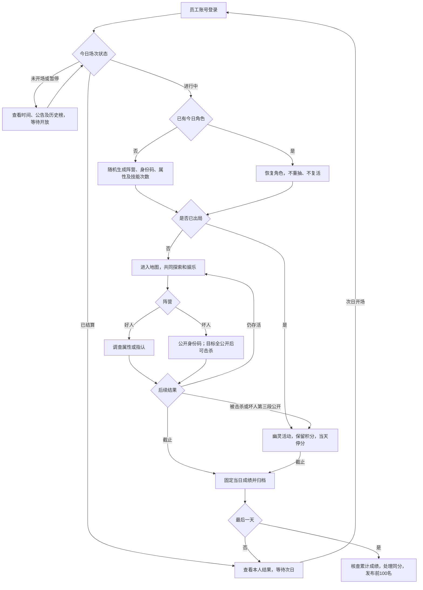
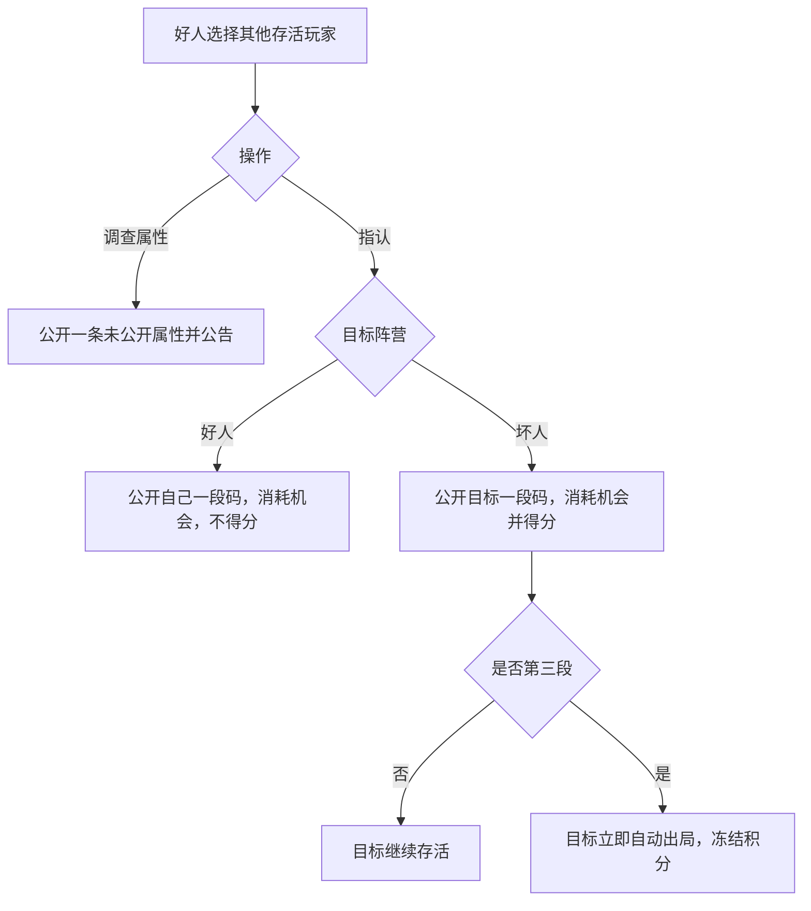
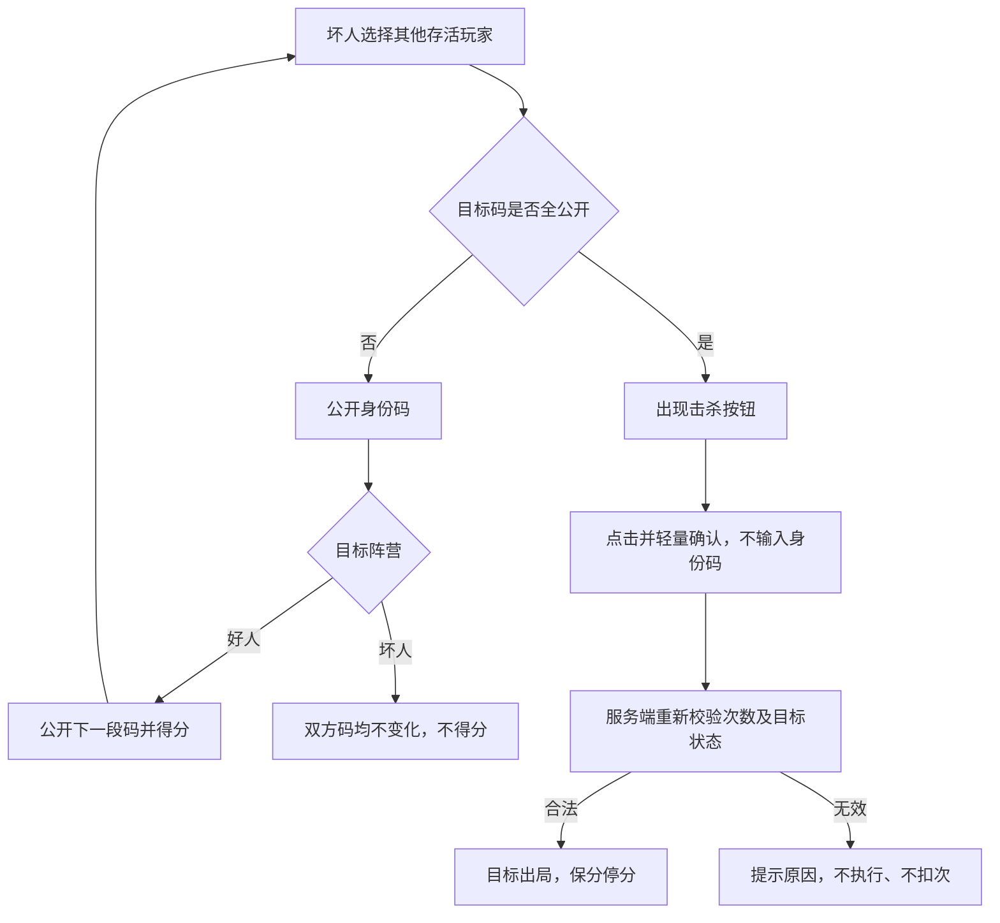

# 年会对抗游戏业务方案

供内部产品、开发、测试及运营讨论。下述为目标业务，尚未实施；比例、具体分值、次数等建议参数集中在末尾确认。

## 一、整体安排

| 项目 | 规则 |
| --- | --- |
| 定位 | 年会整体活动的一个游戏模块 |
| 人数、时长 | 约400—500人，2天至一周 |
| 登录 | 员工账号，一人一个活动身份，不按昵称识别 |
| 每日对局 | 每天一场，随机分配调查员（好人）和潜伏者（坏人） |
| 次日 | 重置阵营、身份码、属性、技能及场内资源，历史积分保留 |
| 出局积分 | 保留所得积分，当天停止获得所有排名积分；每日总分及各类积分均不封顶 |
| 榜单 | 本人看实时积分，公众只看截至昨天的累计成绩 |
| 奖励 | 活动累计积分前100名获奖，已出局者也参与排名 |
| 结束 | 按每日配置截止或管理员结算，不因剩100人或坏人全灭自动结束 |

100是获奖人数，不是每日幸存人数。正式活动与测试场隔离，NPC和测试账号不进入奖励。

同事可以在线下交流、共享线索及协作，不因交流或协作本身认定送分违规；不采用额外的线下交流核查或扣分机制。行动量由服务端技能次数及恢复规则限制，技术作弊、重复账号或重复记账另行处理。

每日开放期间员工自行选择加入时间，不设置统一入场阶段。早加入可以获得更多存活积分和行动机会，也更早暴露在被调查、指认和击杀的风险中；晚加入不补发加入之前的积分或已过去的技能恢复次数。

## 二、两个阵营功能对比

| 项目 | 调查员（好人） | 潜伏者（坏人） |
| --- | --- | --- |
| 操作一 | 调查属性：无论目标好坏，公开一条未公开属性并公告 | 公开身份码：目标好人则公开一段；目标坏人则双方码均不变化 |
| 操作二 | 指认：指中坏人公开目标一段码；指中好人公开自己一段码 | 击杀：其他存活玩家码全公开后显示按钮，点击击杀，无需输入码 |
| 三段全公开 | 不自动出局，可被坏人击杀 | 好人指认公开第三段时立即自动出局 |
| 得分建议 | 正确指认且实际公开新段+10 | 公开好人新段+2；击杀好人+5；击杀坏人0，不扣分 |
| 他人阵营 | 系统不展示，通过线索及结果推断 | 系统不展示，但公开码无效果可以推断目标是坏人 |
| 对自己操作 | 禁止 | 禁止，不能自杀 |
| 出局后 | 保分停分，禁止身份技能，可幽灵逛地图 | 相同 |

好人不具有公开身份码和击杀操作；坏人不具有调查属性和指认操作。两方都可搜索、使用背包和筹码、参加小游戏、看公告和历史榜。

## 三、名词

| 名词 | 定义 | 原有名称/开发标识 |
| --- | --- | --- |
| 调查员（好人） | 调查属性、指认坏人 | good |
| 潜伏者（坏人） | 公开好人码、击杀 | bad |
| 身份码 | 三段，每段3位字母或数字；用于展示公开进度，不再手输击杀 | SID |
| 调查属性 | 随机公开口头禅、食物、运动中的一项 | 探查/probe |
| 指认 | 好人判断目标阵营，公开目标码或本人码 | accuse |
| 公开身份码 | 坏人对好人公开下一段码 | 刺探、窃码/spy |
| 击杀 | 对其他已全公开存活玩家直接执行淘汰 | kill |
| 出局 | 当天停技能和排名分，次日重开 | 死亡、淘汰 |
| 排名积分、筹码 | 前者评奖，后者游戏资源，不互相兑换 | 积分、筹码 |

## 四、员工登录及行动流程

活动结束后登录只查看成绩，不创建新角色。

## 五、公开与出局的明确边界

| 事件 | 公开变化 | 出局结果 |
| --- | --- | --- |
| 调查属性 | 任意阵营目标公开一项属性 | 不出局 |
| 好人指认坏人 | 目标下一段码公开 | 第三段自动出局 |
| 好人指认好人 | 操作者下一段码公开 | 本人码全公开仍存活 |
| 坏人公开好人码 | 目标下一段码公开 | 全公开仍存活，随后可被击杀 |
| 坏人公开坏人码 | 双方均不变化 | 不出局 |
| 坏人击杀全公开目标 | 不新增公开段 | 目标出局 |

每人每天一码，场内唯一，按第一至第三段依次公开；未公开段显示星号，合法公开全员一致。本人完整码默认隐藏，点击查看。移动、搜索、小游戏、锤击、离线、系统属性线索不公开码。

取消血量。坏人第三段公开和出局在同一事务完成，不留可被抢杀或继续行动的中间状态。正常情况下坏人全公开已经出局，所以击杀坏人0分仅为兜底规则。

## 六、操作前提、次数和按钮

| 场景 | 规则 |
| --- | --- |
| 通用前提 | 进行中、未暂停，双方存活、非自己，操作者具备权限及次数 |
| 目标离线或跨楼层 | 可以操作，不设身份技能距离门槛 |
| 属性全部公开 | 调查拒绝，不扣次 |
| 目标码全部公开 | 不再公开码或指认，不扣次，对所有阵营统一处理 |
| 自己全公开仍误指认 | 消耗次数、不得分，只是不再公开新段，不能免费试错 |
| 坏人连续公开同一好人 | 允许，只受次数限制 |
| 坏人公开坏人无效果 | 消耗一次机会，不加分，双方身份码不变化 |
| 击杀按钮 | 仅存活坏人查看其他存活且码全公开玩家时显示，不按目标阵营筛选 |
| 击杀次数不足 | 按钮置灰，提示恢复时间 |
| 击杀提交 | 轻量确认，无输入框；目标已出局等拒绝情况不扣次 |
| 初始/上限建议 | 各2次，具体待定 |
| 恢复建议 | 各技能独立20分钟恢复1次，有次可连续使用，不重置已有恢复节点 |
| 离线、暂停、出局 | 离线存活恢复，暂停冻结剩余计时，出局或结束停恢复 |
| 好人指认限制建议 | 同人每天一次；成功后目标保护5分钟，均待确认 |

坏人从全隐藏公开完目标需3次公开机会，随后击杀另需1次击杀机会。用户举例的三次机会明确了允许连续操作，但未确定初始次数改为3；若希望入场即可完成，应把公开身份码初始和上限设为3。

好人指认保护不限制坏人连续公开好人码。保护状态不主动进入公共档案或公告。

## 七、友好轻提示和公告

| 私人结果 | 提示示例 |
| --- | --- |
| 调查成功 | 调查成功：小王喜欢的运动是游泳，已公开。 |
| 无属性可查 | 对方属性已全部公开，本次未消耗机会。 |
| 指认成功 | 指认成功，公开对方一段身份码，积分+10。 |
| 第三段指认 | 指认成功，积分+10，对方身份码已全部公开，已出局。 |
| 指认失败 | 指认失败，您的第2段身份码已公开。 |
| 误指认但本人全公开 | 指认失败，您的身份码已全部公开，本次消耗1次机会。 |
| 公开成功 | 公开成功，对方第2段身份码已公开，积分+2。 |
| 公开坏人无变化 | 本次公开未产生变化，未获得积分。 |
| 击杀成功 | 击杀成功，积分+5。 |
| 次数不足 | 机会已用完，距离恢复还有12分钟。 |
| 目标已出局 | 对方已出局，本次未消耗机会。 |
| 本人出局 | 您今日已出局，积分已保留，明天可重新参加。 |

等待服务端结算成功再显示，使用“已公开”而非“将公开”。按当前规则实际入账值显示；不抢焦点，出局及得分结果可在私人记录再次查看。不设置积分封顶提示。

| 公共公告 | 示例 |
| --- | --- |
| 属性公开 | 小王喜欢的运动已公开：游泳。 |
| 身份码公开 | 小李的第2段身份码已公开。 |
| 系统线索 | 系统公布：潜伏者03的上衣颜色为蓝色。 |
| 出局 | 小张已出局，今日积分保留。 |
| 场次 | 今日游戏已开始/暂停/结束。 |

调查任何阵营的属性都公告，仅实际新增公开时发公告。不含操作者、指认对错、公开原因、击杀者、目标阵营、积分变化或上线离线。

## 八、线索和信息边界

系统匿名卡逐步公开坏人外观和属性，不给出真人姓名、ID或档案链接。人物调查与系统匿名卡为独立记录，不自动互填。编号当天稳定，出局后保留已有线索，不再新增。建议每30分钟公布一轮，条数需按实际坏人规模校准。

本人可看自己的阵营、完整码、技能、实时积分；其他人只看姓名、外观、已公开码及属性、存活状态。普通接口、搜索、SSE、DOM、剪贴板不得含未公开秘密。

坏人公开另一坏人码无变化，可以据此推断对方阵营；即使提示不明说也能观察结果。隐藏身份指不直接展示，不意味着无法推理识别。

## 九、计分建议

| 类别 | 事件 | 分值 | 获得条件 |
| --- | --- | ---: | ---: |
| 参与 | 首次有效搜索 | +5（建议） | 每日该任务首次完成奖励，不重复领取 |
| 参与 | 首次正常完成指定小游戏，不要求赢 | +5（建议） | 每日该任务首次完成奖励，不重复领取 |
| 存活 | 从当天首次实际入场起，每完整存活30分钟 | +XX（待定，原建议1） | 不限次数、不设分数上限；离线存活也计时，出局或截止停止 |
| 对抗 | 好人指认并实际公开坏人新段，第三次同分 | +10（建议） | 每次合法成功均得分，不设积分上限，受技能次数限制 |
| 对抗 | 坏人公开好人新段 | +2（建议） | 同上 |
| 对抗 | 坏人击杀好人 | +5（建议） | 同上 |
| 对抗 | 坏人公开坏人码无变化或击杀坏人 | 0，不扣分 | — |

每日总积分、存活分、对抗分均不设置上限，不再截断得分，也不因分数高而停止加分。参与任务的一次性奖励属于事件领取条件，不是积分封顶；不因此把重复搜索或小游戏改成无限刷排名分。调查属性、重复小游戏/搜索、锤击、转盘、出售不增加排名分。筹码、成就不折算排名分。NPC不给正式对抗分。参与任务应至少提供一种无需邀请他人的小游戏，取消、未操作超时不算完成。

存活分按个人加入时刻累计，不按所有人的整点或半点统一发放。例如09:10加入，09:40第一次得分，10:10第二次；09:35出局没有满30分钟，不获得第一笔。出局或截止时，已满但尚未入账的周期补齐，不足30分钟的尾段不按比例给分。服务端维护已发周期水位，断线和重启不重复加分。主动暂停期间是否计入存活时长尚需确定，不在本次变更中自行新增口径。

出局时补齐已到期存活分再冻结全部积分；延迟回包或事后补任务不能加分。幽灵不能转移资源给存活玩家或提供全知视野。

比例与分值需重新试玩：现在好人能独立淘汰坏人，坏人能靠无效公开识别同伴，双方机会不同于此前方案。

## 十、恢复、榜单和最终奖励

同日换设备、重连恢复同一角色，不复活、不重抽；离线仍可被合法操作。次日重开重置场内身份与资源，保留活动积分。暂停不顺延截止，结算以服务端统一顺序和接纳边界为准。

本人看今日实时分、明细及自己的累计分；公开榜仅含今天之前已归档成绩，标明截止日期，当日提前结算也不提前公开。第一天显示暂无历史榜，归档失败保留旧榜。最后一天核查后发布含末日成绩的最终榜。

奖励流程：最后场结束 → 汇总本活动员工积分 → 核查异常和重复记账 → 排序 → 处理同分 → 发布前100。出局不取消资格。同分暂建议有效得分对抗次数、再留痕随机；是否要求至少完成一次参与任务待定。合格人数不足100由运营定补充办法。

具体奖品、与其他年会活动重复获奖、发放和申诉由整体活动安排。

## 十一、开发改造及验收

| 范围 | 要求 |
| --- | --- |
| 角色权限 | 好人两项、坏人两项，页面和服务端一致 |
| 自动出局 | 移除血量，坏人第三段公开立即出局；好人全公开不自动出局 |
| 公开码 | 只对好人有效，允许同一坏人连续操作同一好人 |
| 击杀 | 移除手输码，按钮按全公开及存活状态显示，提交重验 |
| 公私提示 | 新增属性公告，结果轻提示用实际入账分，不能泄露操作者 |
| 事务幂等 | 公开、扣次、得分、出局、公告一致；指令重放不重复处理 |
| 并发 | 抢最后段/同时击杀仅合法首个成功，后续目标出局不扣次 |
| 停分 | 第三次指认者正常得分，目标冻结；出局后的任务和小游戏回调不加分 |
| 数据恢复 | 员工、活动、日场关联；事件和积分去重，重启不复活、不重复发分 |
| 榜单 | 不返回其他人今日分、实时总排名或变化，最终发布和导出一致 |
| 容量 | 400—500人参与另明确同时在线峰值，验证广播、行动、数据库及恢复 |

主要涉及角色技能、次数、投影、公告、计分、场次存档及玩家页面。保留探索和小游戏，但关闭变阵营、重抽身份码等破坏线索的转盘奖励。正式/测试隔离，历史分数不自动重算。

## 十二、待讨论细节

| 事项 | 建议/待定点 |
| --- | --- |
| 公开坏人无效果是否扣次 | 已确定消耗一次、不得分；双方身份码不变化，仍可推断阵营 |
| 初始及上限 | 原建议2；如入场即需连续公开三段，公开身份码改为3 |
| 恢复和指认限制 | 20分钟恢复、好人同人每日一次及5分钟保护待确认 |
| 人数、分值 | 80/20及指认10/公开2/击杀5仍需试玩；存活每30分钟+XX待定；已确定每日积分与各类积分不封顶 |
| 击杀坏人 | 正常已自动出局，0分兜底，不引入抢杀中间态 |
| 线索规模 | 公布间隔和数量按实际规模确定 |
| 奖励资格 | 任务门槛、同分及不足100人处理待定 |
| 运营安排 | 日期、每日时间、名单、奖品及跨活动奖励关系 |

本次替代此前“只能被坏人击杀才出局”“坏人也可调查属性”“公开任何阵营都有效”“击杀需手输身份码”的规则。本文件仅更新业务讨论方案，不修改运行程序。

