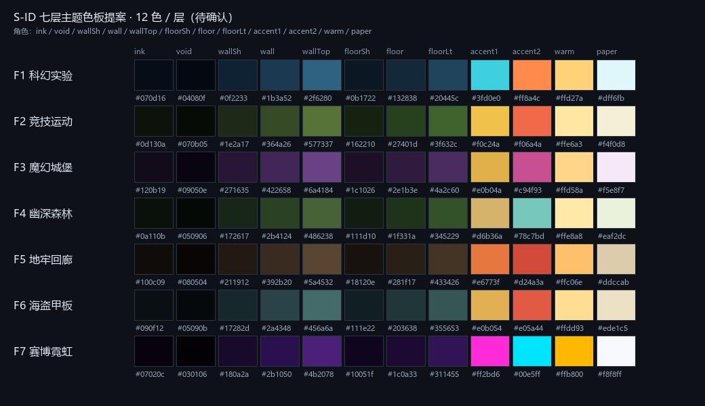

# 七层主题表（第 3 步 · 已确认）

> 状态：**已确认（2026-10-18）**。12 色角色/数值、7 个标志物、新功能区名、技术选 B（90×25 美术格 + 真实 footprint）、电梯取 `floorPortal()` 原坐标——均按本表落地到第 4 步。
> 数据源：`tiled/build-floors.mjs`；主题单一真源：`tiled/themes.mjs`。
> 色板预览：

---

## 0. 统一 12 色角色（每层同序）

| # | 角色 | 用途 | 约束 |
|---|---|---|---|
| 00 | `ink` | 描边、最深阴影 | 只做轮廓/压暗，不做文字色 |
| 01 | `void` | 楼外、井道、不可见区 | 比 `ink` 更黑，压住画面边缘 |
| 02 | `wallShadow` | 墙体背光面 | 与 `wall` 同色相，明度低 1 档 |
| 03 | `wall` | 墙体基色 | 与 `floor` 至少 1 档明度差 |
| 04 | `wallTop` | 墙顶/受光面 | 每层最亮的建筑色，读 3/4 体积 |
| 05 | `floorShadow` | 地面阴影、地毯边 | 不做大面积纯黑 |
| 06 | `floor` | 地面基色 | 主路径与功能区共用，靠 `decor` 分区 |
| 07 | `floorLight` | 地面高光、磨损 | 与 `floor` 明度差 ≤ 2 档，避免棋盘格 |
| 08 | `accent1` | **主路径 / 可交互 / 目标** | 每层唯一签名色，用于门框、路径导视、容器高亮 |
| 09 | `accent2` | **危险 / 封锁 / 次级强调** | 与 `accent1` 色相分开；每层 ≤2 处，不用于普通装饰 |
| 10 | `warm` | 灯光、窗口、安全点 | 全楼统一“暖光=可停留”的语义 |
| 11 | `paper` | 标识、文字、高光 | 只做小面积；与 `floor` 对比 ≥ 7:1 |

**色彩语法（跨层不变）**

1. 玩家不看文字也能读路：`accent1` 沿主路径出现，`accent2` 只出现在死路/危险区入口。
2. 暖光 = 安全/可停留；冷光 = 通行/实验；霓虹 = 高层/赛博。
3. 颜色不单独承载信息：每个功能区同时有**标志物剪影**和**地面材质**，色盲玩家仍可区分。
4. 每层只换色相与材质，不重画墙的明度结构，保证 7 层是同一栋楼。

---

## 1. 7 层 × 12 色总表

| 层 | 主题 | ink | void | wallShadow | wall | wallTop | floorShadow | floor | floorLight | accent1 | accent2 | warm | paper |
|---|---|---|---|---|---|---|---|---|---|---|---|---|---|
| 1F | 科幻实验 | `#070d16` | `#04080f` | `#0f2233` | `#1b3a52` | `#2f6280` | `#0b1722` | `#132838` | `#20445c` | `#3fd0e0` | `#ff8a4c` | `#ffd27a` | `#dff6fb` |
| 2F | 竞技运动 | `#0d130a` | `#070b05` | `#1e2a17` | `#364a26` | `#577337` | `#162210` | `#27401d` | `#3f632c` | `#f0c24a` | `#f06a4a` | `#ffe6a3` | `#f4f0d8` |
| 3F | 魔幻城堡 | `#120b19` | `#09050e` | `#271635` | `#422658` | `#6a4184` | `#1c1026` | `#2e1b3e` | `#4a2c60` | `#e0b04a` | `#c94f93` | `#ffd58a` | `#f5e8f7` |
| 4F | 幽深森林 | `#0a110b` | `#050906` | `#172617` | `#2b4124` | `#486238` | `#111d10` | `#1f331a` | `#345229` | `#d6b36a` | `#78c7bd` | `#ffe8a8` | `#eaf2dc` |
| 5F | 地牢回廊 | `#100c09` | `#080504` | `#211912` | `#392b20` | `#5a4532` | `#18120e` | `#281f17` | `#433426` | `#e6773f` | `#d24a3a` | `#ffc06e` | `#ddccab` |
| 6F | 海盗甲板 | `#090f12` | `#05090b` | `#17282d` | `#2a4348` | `#456a6a` | `#111e22` | `#203638` | `#355653` | `#e0b054` | `#e05a44` | `#ffdd93` | `#ede1c5` |
| 7F | 赛博霓虹 | `#07020c` | `#030106` | `#180a2a` | `#2b1050` | `#4b2078` | `#10051f` | `#1c0a33` | `#311455` | `#ff2bd6` | `#00e5ff` | `#ffb800` | `#f8f8ff` |

> 对比度自检：`paper/floor` 9.8–17.4:1；`accent1/floor` 5.5–8.2:1；`accent2/floor` 3.5–12.0:1（危险色按图形 ≥3:1 校验）。`ink` 只做描边，不承担文字对比。

---

## 2. 逐层：标志物 + 功能区

> 每层都遵守同一条空间规则：**左电梯 → 主路径 → 右电梯**。功能区贴着主路径两侧生长，不另开第二条平行主路。
> 第 4 步的“装饰成组”= 每个功能区 2–3 簇，每簇 2–4 件同族道具，不撒单件。

### 2.1 1F · 科幻实验层

- **一句话**：冷白无尘实验室，唯一暖色是危险警示与应急灯。
- **主标志物**：**中央低温实验舱**——3×3 格玻璃舱，青色内光，主路径绕舱分叉再合流。资产：`controlBox` + `cyberLight` + `neonHolo`。
- **次级标志物**：主控室监控墙（`monitorFace` + `antenna`）。
- **主路径形态**：左电梯 → 西侧检疫闸口 → 北侧样本分析台 → 中央舱环岛 → 东北主控室 → 南侧应急冲洗 → 右电梯。
- **地面**：防静电地板（`floor` 冷蓝），接缝用 `floorLight`；实验舱周围一圈 `accent1` 导视条。

| 顺序 | 功能区 | 玩法职能 | 贴路径位置 | 装饰组（2–4 件/簇） |
|---|---|---|---|---|
| 1 | 检疫闸口 | 入口缓冲、首个可搜点 | 西侧喉口 | 冷光管 + 警示牌 + 样本箱 |
| 2 | 样本分析台 | 工作台/容器位 | 北侧，贴主路 | 监控屏 + 台面 + 试剂箱 |
| 3 | 低温实验舱 | 主标志物、开阔绕行 | 中央 | 冷凝管 + 全息地标 + 护栏 |
| 4 | 主控室 | 控制台/容器位 | 东北，主路旁 | 监控墙 + 机柜 + 天线 |
| 5 | 应急冲洗 | 危险区、死路诱饵 | 南侧支路 | 喷淋 + 警示线 + 排水口 |
| 6 | 东侧电梯厅 | 出口 | 东侧喉口 | 冷光柱 + 楼层牌 |

### 2.2 2F · 竞技运动层

- **一句话**：室内综合运动场，草绿 + 跑道赭红 + 计分牌金。
- **主标志物**：**中央计分塔**——抬高 2 层的四面大屏，主路径从塔下穿过。资产：`tv` + `locker` + `whiteboard`。
- **次级标志物**：跑道拱门（`bench` 拼成门框 + `accent1` 导视）。
- **主路径形态**：左电梯 → 检录更衣 → 南侧跑道直道 → 中央球场（开阔）→ 北侧看台 → 东侧器材库 → 右电梯。
- **地面**：草皮 `floor` + 跑道 `floorLight` 长条；球场边线用 `paper` 细线，不铺满。

| 顺序 | 功能区 | 玩法职能 | 贴路径位置 | 装饰组（2–4 件/簇） |
|---|---|---|---|---|
| 1 | 检录更衣 | 入口、储物柜容器 | 西侧 | 储物柜 + 长凳 + 号码牌 |
| 2 | 跑道直道 | 直线追逐、视野开阔 | 南侧长条 | 锥桶 + 起跑线 + 计时牌 |
| 3 | 中央球场 | 主战场、猜拳/开阔区 | 中央 | 球架 + 边线 + 计分塔底座 |
| 4 | 看台补给 | 休息、补给容器 | 北侧 | 看台长凳 + 饮水站 + 旗帜 |
| 5 | 器材库 | 高风险容器 | 东侧支路 | 器材架 + 木箱 + 垫子 |
| 6 | 东侧电梯厅 | 出口 | 东侧喉口 | 奖杯柜 + 楼层牌 |

### 2.3 3F · 魔幻城堡层

- **一句话**：紫石城堡，金饰与烛火，长廊两侧是拱券。
- **主标志物**：**王座厅魔法阵**——王座 + 地面发光法阵，主路径从法阵边缘绕过。资产：`dgnColumn` + `dgnTorch1` + `neonHolo`（紫色）。
- **次级标志物**：藏书阁螺旋梯（`dgnColumn` 堆叠 + 书架）。
- **主路径形态**：左电梯 → 王座厅（北）→ 中央拱廊 → 藏书阁（南）→ 炼金室（东）→ 宝库（东）→ 右电梯。
- **地面**：紫石 `floor` + 深红地毯 `floorShadow`；法阵用 `accent1` 金 + `accent2` 洋红，仅中心 2 格。

| 顺序 | 功能区 | 玩法职能 | 贴路径位置 | 装饰组（2–4 件/簇） |
|---|---|---|---|---|
| 1 | 王座厅 | 主标志物、开阔厅 | 西北 | 王座 + 石柱 + 烛台 |
| 2 | 藏书阁 | 容器位、窄道 | 西南 | 书架 + 烛台 + 卷轴 |
| 3 | 中央拱廊 | 主路径、伏击点 | 中央 | 拱券 + 旗帜 + 火盆 |
| 4 | 炼金室 | 危险/实验容器 | 中东 | 药瓶 + 木箱 + 头骨 |
| 5 | 宝库 | 高价值容器 | 东侧支路 | 宝箱 + 金币 + 石柱 |
| 6 | 东侧电梯厅 | 出口 | 东侧喉口 | 火炬 + 楼层牌 |

### 2.4 4F · 幽深森林层

- **一句话**：建筑被森林吞没，苔藓、树根、月光下的水。
- **主标志物**：**古树祭坛**——巨型古树 + 环形石座，主路径绕树一圈。资产：`forestTree1` + `forestRock1` + `forestFlowerB`。
- **次级标志物**：溪流石桥（`forestRock2` 拼桥 + `accent2` 水光）。
- **主路径形态**：左电梯 → 林间营地（西）→ 药草圃（南）→ 古树祭坛（中央环）→ 树屋（北）→ 溪流桥（东）→ 右电梯。
- **地面**：苔藓 `floor` + 泥土 `floorShadow`；水用 `accent2` 青色，仅溪流 1–2 格宽。

| 顺序 | 功能区 | 玩法职能 | 贴路径位置 | 装饰组（2–4 件/簇） |
|---|---|---|---|---|
| 1 | 林间营地 | 出生缓冲、休息 | 西侧 | 篝火 + 帐篷 + 木箱 |
| 2 | 药草圃 | 容器位、低矮遮挡 | 西南 | 花丛 + 药草架 + 石臼 |
| 3 | 古树祭坛 | 主标志物、开阔环 | 中央 | 古树 + 石座 + 蓝花 |
| 4 | 树屋 | 高价值容器 | 北侧 | 树屋 + 绳桥 + 木箱 |
| 5 | 溪流桥 | 狭道、冲突点 | 东侧 | 溪石 + 桥板 + 水光 |
| 6 | 东侧电梯厅 | 出口 | 东侧喉口 | 藤蔓 + 楼层牌 |

### 2.5 5F · 地牢回廊层

- **一句话**：湿冷石廊，火把与铁栅，唯一的光是橙色的。
- **主标志物**：**中央铁栅井**——向下的竖井 + 铁栅，主路径绕井成“之”字。资产：`dgnColumn` + `dgnTorch1` + `dgnSkull`。
- **次级标志物**：守卫室火盆（`dgnTorch1` 双联 + 武器架）。
- **主路径形态**：左电梯 → 牢房（西）→ 刑讯室（西南）→ 铁栅井（中央）→ 守卫室（北）→ 水牢（东）→ 宝库（东）→ 右电梯。
- **地面**：湿石 `floor` + 积水 `floorShadow`；火把光只落在 `warm` 小圈，不整体提亮。

| 顺序 | 功能区 | 玩法职能 | 贴路径位置 | 装饰组（2–4 件/簇） |
|---|---|---|---|---|
| 1 | 牢房 | 入口、低价值容器 | 西侧 | 铁栅 + 稻草 + 头骨 |
| 2 | 刑讯室 | 危险区、死路诱饵 | 西南支路 | 铁链 + 火把 + 刑架 |
| 3 | 铁栅井 | 主标志物、垂直视觉 | 中央 | 石柱 + 铁栅 + 火把 |
| 4 | 守卫室 | 中价值容器 | 北侧 | 木桌 + 火盆 + 武器架 |
| 5 | 水牢 | 危险/减速视觉 | 东侧 | 积水 + 铁链 + 石柱 |
| 6 | 宝库 | 高价值容器 | 东侧支路 | 宝箱 + 金币 + 头骨 |

### 2.6 6F · 海盗甲板层

- **一句话**：海风、盐渍木板、金与红帆。
- **主标志物**：**主桅瞭望台**——贯穿两层的主桅 + 瞭望斗，主路径绕桅杆。资产：`dgnColumn`（桅杆）+ `bannerSmall`（帆）+ `dgnBoxes`（货箱）。
- **次级标志物**：船长室海图桌（`dgnChest` + 海图 + 金币）。
- **主路径形态**：左电梯 → 甲板（中央）→ 货舱（南）→ 厨房（西南）→ 船长室（北）→ 炮舱（东）→ 右电梯。
- **地面**：盐渍木 `floor` + 水渍 `floorShadow`；甲板缝用 `floorLight` 长线，不铺满。

| 顺序 | 功能区 | 玩法职能 | 贴路径位置 | 装饰组（2–4 件/簇） |
|---|---|---|---|---|
| 1 | 甲板 | 开阔主战场、主桅 | 西→中 | 桅杆 + 缆绳 + 木桶 |
| 2 | 货舱 | 容器位、窄道 | 南侧 | 货箱 + 木桶 + 吊钩 |
| 3 | 厨房 | 补给容器 | 西南 | 锅灶 + 木桶 + 食材箱 |
| 4 | 船长室 | 高价值容器 | 北侧 | 海图桌 + 宝箱 + 金饰 |
| 5 | 炮舱 | 危险/狭道 | 东侧支路 | 火炮 + 炮弹 + 木箱 |
| 6 | 东侧电梯厅 | 出口 | 东侧喉口 | 灯笼 + 楼层牌 |

### 2.7 7F · 赛博霓虹层

- **一句话**：黑紫底色，洋红/青双霓虹，金色广告。
- **主标志物**：**全息广告塔**——贯穿两层的光柱 + 四面屏，主路径从塔前广场穿过。资产：`antenna` + `bannerBig` + `neonHolo` + `cyberLight`。
- **次级标志物**：天台酒吧霓虹招牌（`hotelSign` + `bannerSmall`）。
- **主路径形态**：左电梯 → 霓虹街（西）→ 黑市（南）→ 服务器机房（中）→ 全息塔广场（中东）→ 义体诊所（北）→ 天台酒吧（东）→ 右电梯。
- **地面**：黑色金属 `floor` + 霓虹条 `floorLight`；`accent1` 洋红主路，`accent2` 青色只做危险/水光/次级导视。

| 顺序 | 功能区 | 玩法职能 | 贴路径位置 | 装饰组（2–4 件/簇） |
|---|---|---|---|---|
| 1 | 霓虹街 | 入口、第一容器 | 西侧 | 霓虹牌 + 售货机 + 广告屏 |
| 2 | 黑市 | 高风险容器 | 南侧支路 | 木箱 + 全息标 + 帘布 |
| 3 | 服务器机房 | 中价值容器、窄道 | 中央 | 机柜 + 线缆 + 冷光 |
| 4 | 全息塔广场 | 主标志物、开阔区 | 中东 | 光柱 + 大屏 + 地灯 |
| 5 | 义体诊所 | 补给/容器 | 北侧 | 手术台 + 霓虹 + 药柜 |
| 6 | 天台酒吧 | 休息、出口前最后一口 | 东侧 | 吧台 + 招牌 + 霓虹灯 |

---

## 3. 跨层检查

| 检查项 | 结果 |
|---|---|
| 每层是否只有一个 `accent1` 签名色 | ✅ |
| `accent2` 是否只用于危险/封锁/次级强调 | ✅（F1 警示、F2 越界/危险、F3 法阵副色、F4 深水、F5 血/火、F6 红帆/炮、F7 青色危险/水光） |
| 每层是否有唯一剪影标志物 | ✅ 低温舱 / 计分塔 / 王座法阵 / 古树祭坛 / 铁栅井 / 主桅 / 全息塔 |
| 功能区是否都贴主路径 | ✅ 每层 6 个功能区，4 个贴主路、2 个短支路 |
| 是否避免“单件装饰撒芝麻” | ✅ 每区 2–3 簇，每簇 2–4 件同族道具 |
| 色盲可读性 | ✅ 颜色 + 剪影 + 地面材质三重冗余 |
| 7 层是否同一栋楼 | ✅ 共用 12 角色明度结构，只换色相/材质 |

---

## 4. 确认结果（已落地到第 4 步）

1. **12 色角色顺序**已按上表固定：`ink → void → wallShadow → wall → wallTop → floorShadow → floor → floorLight → accent1 → accent2 → warm → paper`。
2. **7 个主标志物**全部保留：低温实验舱 / 计分塔 / 王座法阵 / 古树祭坛 / 铁栅井 / 主桅瞭望台 / 全息广告塔。
3. **功能区命名**使用本表新名字（每层 6 个主题功能区；F1–F4/F6 另加东侧电梯厅，F5/F7 由东侧功能区兼作出口）。
4. **主路径形态**已按“每层不同、都从左电梯到右电梯”落地。
5. **碰撞技术选 B**：90×25 美术格保留，家具/门框走 `props` 对象层的真实 footprint（可跨格、可半格）。
6. **电梯坐标**：`lift-*` 的 x/y/w/h 直接取 `WORLD.floorPortal(id, side)` 原坐标除以 `FLOOR_SCALE`，不吸附；电梯厅是楼板外的虚拟带（144×96 world），不写进 tile 层。

> 确认前的旧待确认项已关闭；后续若要改主题，先改 `tiled/themes.mjs` 与本文，再跑 `build-floors.mjs`。
>
> 第 4 步落地修订（2026-10-18）：1F–4F/6F/7F 为“84×19 楼板 + 2 格环廊/主路径 + 2 格厚隔墙 + 结构柱/设备间”；5F 改为 1 格宽走廊迷宫 + 石室，搭配战争迷雾；7 层均已接真实素材。空地率 39.1–62.4%，实际可达 53.6–62.3%；5F 厚墙 19.6%，其余 9.5–10.1%。容量见 `tiled/CAPACITY.md`。

